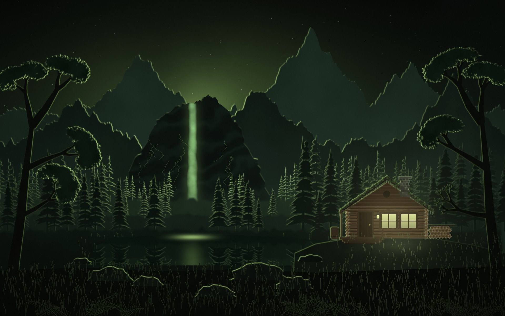

# Salad Live

Живые обои для GNOME: ночной лес, светящийся водопад и бревенчатый домик под дождём.
Палитра — мягкий чёрный и салатовый, стиль — ночная фэнтези-иллюстрация с неоновой
контурной подсветкой.



## Что движется

- дождь в три слоя (дальний, средний, ближний), у света окон и водопада он заметнее;
- круги от капель на пруду и на земле;
- струи и пена водопада, рябь и блики на пруду, отражения колышутся;
- туман плывёт между слоями леса и над водой;
- дым из трубы;
- свет в окнах и фонарь у двери мерцают;
- светлячки;
- волны света бегут по кронам;
- трава и листва качаются на ветру.

Анимация считается на видеокарте в реальном времени и не повторяется.

## Установка

Скачай архив из [Releases](https://github.com/vyugov76/salad-live/releases/latest) и выполни:

```bash
tar xf salad-live-*.tar.gz
cd salad-live-*/
sudo ./install.sh
```

Установщик:

1. проверит зависимости и, если чего-то нет, предложит поставить их через `apt`;
2. разложит файлы по системе;
3. добавит автозапуск при входе для всех пользователей;
4. поставит и включит расширение GNOME Shell: оно держит обои под значками рабочего стола
   и ставит их на паузу, когда стол не виден (см. ниже);
5. предложит поставить кадр сцены как статичные обои: его видно в обзоре и на экране блокировки;
6. сразу запустит обои, и в верхней панели появится значок-ёлочка.

Без sudo, только для себя:

```bash
./install.sh --user
```

Ключи: `--yes` (без вопросов), `--no-deps`, `--no-start`, `--no-wallpaper`.
Переменная `DESTDIR=/путь` — установка в каталог без запуска (для сборки пакетов).

### Что куда ставится

| Что | В систему (`sudo`) | `--user` |
|---|---|---|
| Программа и сцена | `/usr/local/share/salad-live/` | `~/.local/share/salad-live/` |
| Команда `salad-live` | `/usr/local/bin/` | `~/.local/bin/` |
| Автозапуск | `/etc/xdg/autostart/salad-live.desktop` | `~/.config/autostart/salad-live.desktop` |
| Ярлык в меню | `/usr/local/share/applications/` | `~/.local/share/applications/` |
| Расширение GNOME Shell | `/usr/local/share/gnome-shell/extensions/salad-live@vyugov76.github.io/` | `~/.local/share/gnome-shell/extensions/…` |
| Настройки | `~/.config/salad-live/settings.json` | то же |

### Требования

- GNOME Shell 45–50 (сеанс Wayland или X11; на Wayland нужен XWayland — в GNOME он есть по умолчанию);
- Ubuntu 24.04+ или другой Debian-подобный дистрибутив (для других — поставь зависимости вручную и запусти с `--no-deps`);
- видеокарта с OpenGL (подойдёт встроенная Intel/AMD);
- для значка в трее — расширение AppIndicator (в Ubuntu включено по умолчанию).

Зависимости: `python3-gi python3-gi-cairo gir1.2-gtk-3.0 gir1.2-gstreamer-1.0 gir1.2-gst-plugins-base-1.0
gstreamer1.0-plugins-base gstreamer1.0-plugins-good gstreamer1.0-gl gir1.2-ayatanaappindicator3-0.1`.

## Управление

Значок-ёлочка в верхней панели:

- **Настройки…** — мини-окно с ползунками, изменения видны сразу и сохраняются;
- **Пауза** — заморозить картинку;
- **Выключить живые обои**.

| Раздел | Ползунки |
|---|---|
| Дождь | скорость, плотность |
| Светлячки | количество (0–40), яркость |
| Домик | свет в окнах, мерцание, дым из трубы |
| Природа | волны света, туман, течение воды, ветер в траве |
| Кадров в секунду | 15 / 20 / 24 / 30 |

Команды:

```bash
salad-live              # запустить (повторный запуск перезапускает)
salad-live --settings   # открыть настройки
salad-live --stop       # выключить
salad-live --version
```

## Экономия ресурсов

Обои не рисуют впустую, когда их никто не видит.

| Ситуация | Что делают обои |
|---|---|
| Рабочий стол закрыт окнами (развёрнутое, полноэкранное или несколько окон закрывают ≥92% экрана) | пауза, 0 кадров |
| Открыт обзор (Super) | пауза — там показывается статичный кадр |
| Экран заблокирован или погашен | пауза |
| Ноутбук работает от батареи | частота снижается до 12 кадров/с |
| Стол снова виден / разблокирован / подключена зарядка | анимация продолжается с того же места |

Как это устроено:

- **Видимость рабочего стола.** На Wayland обычная программа не может узнать, закрыт ли
  рабочий стол чужими окнами, — это знает только оболочка. Поэтому в комплекте есть маленькое
  расширение GNOME Shell (`extension/`). Оно следит за окнами текущего рабочего пространства:
  берёт обычные несвёрнутые окна и по сетке 24×24 оценивает, какую долю рабочей области каждого
  монитора они закрывают с учётом перекрытий. Результат оно отправляет обоям по D-Bus
  (`io.github.vyugov76.SaladLive.SetDesktopVisible`), только когда состояние меняется,
  и не чаще 4 раз в секунду. Окна обоев и значков рабочего стола (DING) не учитываются.
- **Блокировка экрана** — сигнал `org.gnome.ScreenSaver.ActiveChanged`.
- **Батарея** — свойство `OnBattery` у UPower.

Если расширение выключено или не подходит к версии GNOME, обои работают как обычно, просто без
паузы при закрытом столе. Новое расширение GNOME подхватывает **после повторного входа в систему**.

В `~/.config/salad-live/settings.json` есть параметры без ползунков:

- `battery_saver` (`true`/`false`) — снижать частоту от батареи;
- `battery_fps` (по умолчанию `12`).

Замеры на Intel UHD (Alder Lake-U), один процесс, % одного ядра:

| Режим | Обои | Композитор GNOME |
|---|---|---|
| Анимация, 24 кадра/с | ≈4% | ≈+10% |
| Анимация от батареи, 12 кадров/с | ≈2,5% | меньше |
| Пауза (стол закрыт / экран заблокирован) | 0% | без нагрузки от обоев |

## Как устроено

```
src/paint.py      рисует сцену один раз → scene.png + consts.glsl + still.png
src/scene.frag    шейдер GLSL: вся анимация, каждый кадр
src/salad-live.py окно-«рабочий стол», GStreamer-конвейер, трей, настройки, D-Bus
extension/        расширение GNOME Shell для экономии
```

- **Картина** (`paint.py`, numpy + Pillow): процедурные горы, утёс, ели из отдельных лап
  с иголками, лиственные деревья (рекурсивные ветви + сотни «мазков» листвы), домик, пруд
  с отражениями. Неоновая обводка — это контур силуэта, повёрнутый к источнику света.
  Результат — текстура 1920×2400: сверху цвет, снизу четыре маски (листва, вода, глубина
  для тумана, что качается от ветра).
- **Анимация** (`scene.frag`) считается на видеокарте через GStreamer:
  `imagefreeze ! glshader ! glimagesink`. Настройки передаются в шейдер как uniform-переменные
  на лету. Всё периодическое повторяется ровно за час, и раз в полчаса время незаметно
  «перематывается» назад, чтобы float32 в шейдере не терял точность за дни работы.
- **Окно** запускается через XWayland с типом `_NET_WM_WINDOW_TYPE_DESKTOP` и классом
  `salad-live`. Mutter держит его в самом нижнем слое, под обычными окнами, не показывает
  в Alt-Tab, доке и обзоре. Область ввода пустая, поэтому клики проходят сквозь окно.
- **Значки рабочего стола остаются рабочими.** Окно значков (DING, «Desktop Icons NG»)
  лежит в том же слое, что и обои, и при каждом открытии или закрытии окна опускает себя
  на самое дно, то есть под обои. Расширение при каждой перестановке окон (`restacked`)
  возвращает обои под значки. Файлы на рабочем столе видны, открываются, перетаскиваются,
  правый клик работает как обычно.

### Своя версия леса

```bash
python3 src/paint.py src --seed 12   # другая случайная раскладка деревьев, гор, травы
./install.sh                         # переустановить
```

Цвета, композиция и домик задаются в `paint.py`, анимация — в `scene.frag`.

## Удаление

```bash
sudo ./uninstall.sh          # или ./uninstall.sh --user
sudo ./uninstall.sh --purge  # вместе с настройками
```

## Ограничения

- Проверено на Ubuntu 26.04, GNOME 50 (Wayland), Intel UHD. На других системах должно работать,
  но не проверялось.
- Сцена рисуется в 1920×1200 и растягивается под экран; на экранах с другим соотношением сторон
  картинка слегка растянется.
- Расширение начинает работать после повторного входа в систему. До этого обои опускаются
  под значки только при запуске, и значки могут пропадать после открытия окон.

## Лицензия

[MIT](LICENSE)
